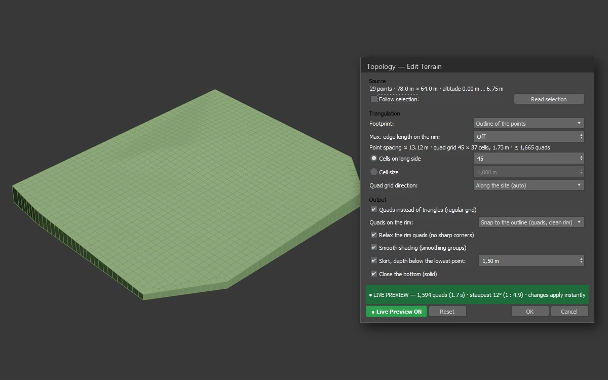

# Topology — terrain for 3ds Max



Builds a terrain from **contour splines**, from **points** or from the **spot heights
of a site plan (PDF)** — for site models, landscape and urban planning, ready for
rendering and scattering. Clean all-quad topology on request.

[Deutsch → LIESMICH.md](LIESMICH.md)

## Requirements
- **3ds Max 2025 or newer** (tested with 3ds Max 2027). The tool uses PySide6 (Qt 6)
  and the menu system that came with 3ds Max 2025; 3ds Max 2024 and older are not
  supported.
- **numpy** in the Python of 3ds Max — see [numpy](#numpy) below. Topology offers to
  install it with one click the first time you start it.

## Installation
1. Download `Topology-3dsMax-<version>.zip` from the [latest release](../../releases/latest).
2. Unzip it into `%APPDATA%\Autodesk\ApplicationPlugins\` — you get
   `...\ApplicationPlugins\PESI3D-Tools\PackageContents.xml`.
3. Restart 3ds Max → menu **PESI3D ▸ Topology ▸** *Terrain from Contours… · Terrain from
   Points… · Terrain from Plan… · Edit Terrain…* and the dockable **PESI3D** toolbar.

All commands are also MacroScripts in the category **PESI3D** (Hotkey Editor, Menu
Editor, quad menus). To uninstall, delete the `PESI3D-Tools` folder.

**Upgrading from the stand-alone Topology 1.0 (.mzp):** first delete its files in
`%LOCALAPPDATA%\Autodesk\3dsMax\<year> - 64bit\ENU\`: `scripts\startup\PESI3D_Topology.ms`,
`scripts\PESI3D\pesi_topology.py` and `usermacros\PESI3D-Topology_*.mcr`. Hotkeys and
toolbar buttons keep working (same MacroScript names); terrains made with 1.0 can be
edited with *Edit Terrain…*.

## Features
- **Terrain from Contours…** — select contour splines lying at their heights. A regular
  grid with smooth interpolation between the lines (no terraces); rounded or flat
  **summits & pits**; **Smooth surface (radius)** removes the creases at the lines.
  **Clean up lines**: Simplify, Smooth, Ignore lines shorter than — non-destructive.
- **Terrain from Points…** — Point helpers, mesh/poly vertices or spline knots. A
  Delaunay TIN exactly through every point; long rim triangles can be trimmed.
- **Terrain from Plan…** — reads the **spot heights of a site plan** (vector PDF:
  +402,35 · 403.120 · KD …) with their point symbols. The scale comes from the plan or
  is **measured with two clicks**; check the points on the sheet (green = used, orange =
  left out), switch codes such as floor levels or pipe inverts on/off, keep real
  heights or start at 0. The view zooms to the new terrain.
- **Footprint** — outline · rectangle interpolated to the full box · rectangle cut
  inside the data.
- **Quads instead of triangles** — a regular grid, every face a quad, the vertices
  numbered row by row. For points/plans the grid turns along the site.
  **Quads on the rim**: *Whole cells only* (stepped rim) · *Snap to the outline* (a
  ring of quads exactly on the outline, corners included) · *Cut to the outline*
  (contours, n-gons on the rim). **Relax the rim quads** evens out the ring.
- **Skirt** and **closed bottom** — a watertight solid; with quads the bottom is a
  quad grid too. Contours and a flat contour map as child splines.
- **Smoothing groups** done right: smooth slopes, sharp folds (> 45°), sharp skirt
  corners.
- **Live Preview** — the real result in the scene while you change settings
  (**● Live Preview ON**, status line, Reset); the dialog does not block the viewport.
  **OK** is one undo step, **Cancel** leaves nothing behind.
- **Edit Terrain…** — the terrain remembers its source and settings; select it and
  change anything later.
- Lengths are entered in metres and work with any system unit. Safety limit at
  1,000,000 triangles (override at your own risk).

Example plan: [site_plan_spot_heights_1-200_A3.pdf](https://github.com/PESI3D/ingetrazo-topology/blob/main/examples/site_plan_spot_heights_1-200_A3.pdf)
(an invented site plan, from the IngeTrazo version of Topology).

## numpy
numpy is a **separate installation** — a free, open-source Python package (BSD
licence), not part of 3ds Max and not inside this zip. The first time you start a
Topology tool it asks and installs it with one click (internet needed, no admin
rights; `pip install --user numpy` with the Python of 3ds Max, with a progress
window). If 3ds Max asks for it, restart once afterwards.

It goes into your user folder (`%APPDATA%\Python\Python3xx\site-packages`), once **per
Python version** of 3ds Max: 3ds Max 2025/2026 use Python 3.11, 3ds Max 2027 uses
Python 3.13. All plugins of that 3ds Max share it; uninstalling Topology leaves it in
place (`python.exe -m pip uninstall numpy` removes it). By hand (adjust the year):

```
"C:\Program Files\Autodesk\3ds Max 2027\Python\python.exe" -m ensurepip --upgrade --user
"C:\Program Files\Autodesk\3ds Max 2027\Python\python.exe" -m pip install --user numpy
```

## Problems?
Errors are written to `%LOCALAPPDATA%\PESI3D\3dsMax\pesi3d.log` (**PESI3D ▸ Open log
folder**). Please open an [issue](../../issues) with the log and, if possible, a small
example file.

## Changelog
- **1.2** — first release of the 3ds Max version as part of **PESI3D Tools** (one
  PESI3D menu and toolbar for all PESI3D tools): **Terrain from Plan…** (spot heights
  from a site plan PDF); **clean quads** for contours, points and plans with a choice of
  rim (whole cells · snap to the outline · cut) and relaxed rim quads; quad bottom;
  smoothing groups like Auto Smooth 45° and sharp skirt corners; sliver triangles at
  the rim removed; the plan preview zooms to the terrain; numpy installs with one click.
- **1.0** — stand-alone script (.mzp): terrain from contours or points, live preview,
  Edit Terrain.

## For developers
Topology is built on a small framework (`Contents/python/pesi3d_max/`): plugins are
modules in `pesi3d_max/plugins/` with `NAME` and `setup(app)`; `pesi3d_max.preview`
gives the PESI3D live-preview dialog; `examples/hello.py` is a template.
`tools/install_dev.ps1` links a working copy into `ApplicationPlugins`; tests without
3ds Max: `python -m unittest discover -s tests`; release zip: `tools/build_release.ps1`;
smoothing audit inside 3ds Max: `tools/audit_smoothing.py`.

## Licence
GPL-3.0-or-later · © 2026 Pesi (pesi3d.de) · [Impressum](https://pesi3d.de) — see
[LICENSE](LICENSE).

Bundles [pypdf](https://github.com/py-pdf/pypdf) 6.19 (BSD-3-Clause, licence in
`Contents/python/pesi3d_max/plugins/topology/_vendor/pypdf/LICENSE`) to read PDF plans.

Not affiliated with or endorsed by Autodesk. 3ds Max is a trademark of Autodesk, Inc.
